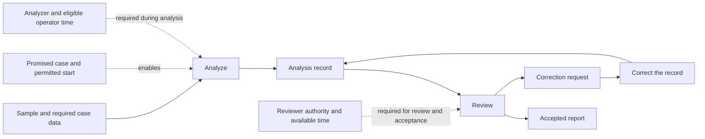
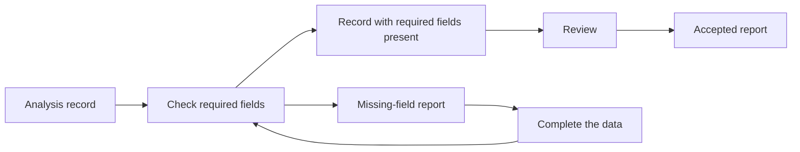

## OPS.11.1 - Construct and Reconcile Operating Models Across Scales

> **Type:** Method pattern
> **Status:** Stable
> **Normativity:** Normative

### OPS.11.1:1 - Problem frame

**Use this when** the operation needs a way to obtain a required result, or an operating change looks useful in one account of the work but its consequence cannot be recovered in another. A department appears to have spare capacity while the person doing its work is already occupied elsewhere. A laboratory reports completed samples while the customer needs a complete order. A team can describe individual tasks but cannot explain what controls delivery by the wider service.

Construct the operating arrangement needed for the decision, then connect its local and wider accounts. Here a model is a description used to obtain an answer about the operation. A drawing, a set of conditions, a calculation or a simulation can serve that use. Keep the description distinct from the actual work and its arrangement.

**First useful move.** Choose one recipient's result and the current difficulty in obtaining it. Recover an available way of doing the necessary work, or identify the missing professional contribution. Follow a present or proposed case through its resources and completion conditions, or recover what maintains the required service over its interval. Where two descriptions refer to the same worker, order or event, bring those references together before calculating.

**Practical gain.** The manager can compare feasible arrangements without mistaking local capacity for available shared capacity or local completion for delivery. The result may also identify the particular coupling that makes a proposed change fail.

The reader needs to understand the work well enough to identify its participants and events, or work with someone who does. The elementary cases below need arithmetic and time intervals. A more demanding calculation can be obtained from a modeling specialist.

Use an adequate existing operating model directly when its assumptions and retained detail answer the present question. A staffing total alone may settle a proposed start. This method is useful when choosing or reconciling the model changes the answer; it does not require a description of the whole enterprise.

### OPS.11.1:2 - Problem

Descriptions at different scopes can each look reasonable while making incompatible assumptions about the same operation. A resource appears once in each departmental plan and is then treated as two resources. An internal exit becomes the completion event of an external service, although acceptance still takes time. Several samples are aggregated to one order without retaining which sample prevents delivery.

A desired service can also lack an adequate operating arrangement. A deadline names the result but leaves open how work should be divided, prepared and provided. Comparing only schedules for the existing route can miss a useful change to that route; drawing a different route can hide the technical method or provision that it still needs.

Adding detail everywhere makes the account harder to build, interpret and maintain. Keeping only totals can erase the dependence that matters. The practitioner needs a way to construct an attainable arrangement and retain its consequential dependencies while leaving irrelevant detail out.

### OPS.11.1:3 - Forces

| Force | Tension |
| --- | --- |
| Required result and available way | A desired service can motivate another arrangement, but a drawn operation supplies neither a qualified method nor its provision. |
| Local understanding and shared operation | Each team knows its work; a common resource or receiving condition crosses team boundaries. |
| Compactness and useful distinction | An aggregate is easy to use until two cases with the same aggregate require different decisions. |
| Stable account and changing policy | A useful service approximation can cease to apply after routing, release or staffing changes. |
| Several working questions | An order deadline, machine load and cash receipt concern related but different subjects and events. |
| Timely decision and additional inquiry | An unresolved premise can matter, but obtaining more detail costs time and may leave the decision unchanged. |

### OPS.11.1:4 - Solution

Specify the needed outside result, recover the work that obtains or maintains it, reconcile shared participants, and connect the quantities and events at each useful scale. Refine an account when its omitted distinction can change the proposed action. Return the resulting comparison with the conditions on which it depends.

#### OPS.11.1:4.1 - Fix the receiving result and the proposed change

State what the recipient must obtain and which event or continuing condition makes it available. For an order, this may require accepted components, transport and permission to use the result. For a machine service, it may be restored operation. An incident service can instead require qualified response to remain obtainable throughout a covered interval. Use the completion or service condition of the present or proposed operation and keep any proposed change to that condition explicit.

Name the alternative under consideration: another release time, a different allocation, a larger transfer batch, changed routing or another operating method. Identify the quantities that would make the alternative preferable and any conditions it must preserve. When no adequate arrangement has yet been proposed, construct alternatives through :4.2a from the result, available methods and missing contributions. OPS.1 supplies the operating focus and OPS.19 the wider reconciliation when several results govern the choice.

Retain the difference between a fixed input and a decision variable. If a contractor's two-day turnaround is a commitment that cannot change, the present model can use it as an input. If the proposal changes how that contractor is used, recover the response to that change rather than assuming the same turnaround.

#### OPS.11.1:4.2 - Recover what obtains the result

For a case, follow its relevant arrival to its receiving completion. For a continuing service, identify the condition that must be maintained, the work that preserves it and the events that require a response. At each consequential action, identify the required input, what can happen next, the condition that enables it and what it produces. Include external work when the result depends on it, even if that work is absent from the organization chart.

Separate the route from the resources used along it. For each consequential operation, determine which resources it holds and for how long. A machine may hold a part throughout a cycle while needing an operator only for loading and unloading. A person may be shared between apparently separate stations. A pool may provide alternatives only when the members have the needed capability and access.

Recover joins and returns. Two component outputs may both be needed before acceptance; a correction may revisit a resource already assigned to new work. A release rule must then account for unfinished obligations as well as newly admitted cases.

Represent the relevant network of transformations and conditions. Distinguish an input or result passed to another operation, a resource used by several operations, and a condition that enables an operation. Label those relations in a diagram or state them in a table. An arrow without a stated meaning can hide whether a result is needed, a person is occupied or someone must authorize the action. A route may branch, join or return; it need not be one predetermined sequence.

Connect that network to the commitments and authority on which it relies. Identify who can request, promise, declare completion and accept the relevant result. Those acts can themselves take time and consume resources. Their organizational meaning and their resource demand answer different questions. Counting a person's existing assignments establishes demand on that person; it does not establish or redesign the person's authority.

Compare an alternative by stating what changes: a transformation, its required inputs or outputs, an enabling rule, resource occupancy, a commitment or an authority relation. Keep unchanged relations available for reuse. A changed release limit or route does not by itself establish a change to the organization's roles. Conversely, leaving the boxes and job titles unchanged does not establish that people can exercise a newly assigned responsibility.

A.22.CGUS helps express available continuations and their conditions before fixing a sequence. OPS.8 supplies readiness and release policy. Use the existing description of those relations when it already conveys them; the work does not require a particular diagram.

#### OPS.11.1:4.2a - Construct alternatives when the arrangement is not given

Work back from the recipient's required result to the contributions it needs. For each contribution, recover a qualified way of obtaining it, the input it requires, the result it supplies and the conditions under which the receiver can use it. Use the actual professional explanation or a competent provider's result. Where no adequate way is available, return that method or research question through FPF C.39 and the relevant discipline. A box labeled with the desired outcome cannot yet support a resource estimate or a promise.

Use an existing workable route as the first alternative when one is available. Locate the dependency that prevents it from meeting the present need. Construct another arrangement by changing that dependency while preserving the required result. The following questions expose different ways of doing so:

- **What can be prepared before a particular request is known?** Separate reusable preparation from work that depends on that request. Identify how long the prepared result remains usable, which later work consumes it and what can make it obsolete. Compare stock and preparation burden with the delay avoided after arrival.
- **Where can a smaller contribution become useful?** Choose work and transfer boundaries from readiness and receiving conditions. Compare smaller transfers with the setup, checking and coordination they add. Keep a required join even when its constituents travel separately.
- **Which provision can change?** Compare qualified alternative resources, routes or providers, including their setup, response, access and existing load. A shared preparation or support service can replace repeated work only when its result is usable in each receiving case.
- **Where can the operation accommodate variation?** Compare available capacity, suitable prepared inputs and permitted waiting for the same service question. Include the replenishment or recovery that makes the protection sustainable. Preserve the supplied limit when delay, storage or interruption is inadmissible.

These are possible changes, not required ingredients of every model. Develop the alternative whose mechanism addresses the difficulty. In a familiar case, one changed allocation can suffice. When changes across methods, performers and means must be constructed together, FPF C.32.MWA.PP:4.3–4.7 supplies that comparison. This operating model then retains the particular unit, readiness, occupancy and timing relations needed to calculate its consequences.

Follow the proposed work forward. Show how each intermediate result becomes usable, how common preparation and recurring work are counted, where resources coincide or conflict, and how acceptance is reached or service is maintained. Count displaced work and the transition from the present arrangement. Sections :4.3–4.6 reconcile and compare these accounts. Reject a candidate that merely moves the missing contribution to another participant who cannot supply it.

Separate three possible returns. A rearrangement within established methods and authority can proceed to the operating choice. A changed reusable method needs the method comparison and evidence in OPS.16–OPS.17. Changed organizational contribution or authority relations need OCE.4, OCE.6 and their realization conditions. These contributions can cooperate, but the model keeps each proposed change conditional until its required result is available. When no feasible alternative remains, return the particular requirement or unavailable contribution to its decision maker; a more elaborate model need not be the next useful work.

#### OPS.11.1:4.3 - Reconcile shared participants and operating conditions

Compare the local accounts at their connections. Establish whether two resource names denote the same resource, interchangeable members of a pool, or different resources. Do the same for cases, batches, deliveries and completion events.

Apply the constraint once to the actual shared participant. If one operator serves two stations, both demands compete for that person's available intervals. If one vehicle carries several orders together, those orders share the trip; their inclusion does not create several vehicle trips.

Compare calendars and eligibility. Six hours of available labor and six hours of eligible work can remain incompatible when they occur at different times or require different skills. Conversely, an unattended stage can permit another operation during part of the same elapsed interval.

Keep different receiving questions distinct. The project sponsor's completed result, the performer's completed assignment and the administrator's settled expense can have different boundaries. Connect the relevant events instead of treating the shared word “completed” as an identity. OPS.3 supplies subject recovery; F.0.1 and F.9 help when local meanings or their correspondence remain unresolved.

#### OPS.11.1:4.4 - Connect the quantities and events across scales

Choose the relationship needed between the accounts. Sometimes a wider quantity is a sum of disjoint local quantities. Sometimes it is a union, a maximum, a rate over an interval or a conditional response. Derive that operation from the receiving question.

For example, an order requiring every component becomes ready at the latest required component completion, provided no further work remains. Adding component completion times would describe neither that event nor the elapsed time. Parts processed together in a feasible machine batch share its occupation; take the union of that machine's occupied intervals when calculating its busy time.

When aggregating, preserve the condition under which the summary is usable. A department's average service rate may help a sustained-load question but leave the deadline of a particular batch unresolved. A sample-count summary may omit which order is waiting for its final sample.

To construct a sufficient summary, first express the requested result in the quantities you propose to retain. Derive the answer from those quantities and their stated conditions. If an omitted detail still enters the answer, look for two allowed arrangements with the same summary and different answers. Such a pair disproves sufficiency; failing to find one does not establish it. Retain the distinguishing relation, derive a useful bound, or restrict the answer. In the laboratory case below, the sample-to-order relation and the latest required completion provide the order's completion event; sample totals alone cannot. C.29.1 develops this construction and preservation question. MMP.18 constructs compatible exchanges when mathematical models must be coupled, including shared quantities, time scales, feedback and uncertainty.

#### OPS.11.1:4.5 - Refine the part that can reverse the choice

Start from the smallest available account that addresses the question. Open a local part when a consequential result depends on its hidden timing, sharing, variation, return or completion condition.

A service block described by a fixed delay can be adequate for a question that leaves its load and resources unchanged. If the proposed release creates congestion inside that block, replace the fixed delay with the load-sensitive account needed for the comparison. Keep unaffected neighboring blocks at their sufficient level of detail.

Changing scope and changing detail are different moves. Adding a subcontractor widens the modeled operation. Showing the subcontractor's internal batching adds detail. The first can be necessary while the second is irrelevant because the contract already supplies the required response.

Identify uncertainty separately from a deliberate simplification. “The loading time is unknown” calls for an estimate, range or observation if the answer depends on it. “We combine identical loading steps” is a modeling choice whose effect can be compared. C.11.DUA governs whether resolving an uncertainty is worth more than a restricted answer or a different action.

#### OPS.11.1:4.6 - Obtain and interpret the operating alternatives

Translate the recovered conditions into a form from which the requested result can be obtained. MMP.10 constructs constraints; OPS.10 selects the service and capacity question. Use a hand calculation when it suffices, or choose a computational procedure under C.29.2 and the relevant CMP methods.

Check the obtained alternative against the operating arrangement. Can the people and equipment occupy the proposed intervals? Are the receiving inputs available together? Does the calculated final event make the result usable? A schedule can satisfy a mistaken model, so successful computation alone does not settle these questions.

For a comparison across scales, return the local change and its wider consequence together. Explain where a delay, burden or unfinished obligation moves. OPS.14 supplies financial consequences when they can change the choice; their quantities need their own interpretation.

Stop with a sufficient comparison or the missing contribution that prevents one. Retain the assumptions a recipient needs to use the result. When routing, resources, calendars or acceptance changes, revise the affected account and propagate the change through the relationships that consumed it.

### OPS.11.1:5 - Archetypal Grounding

#### OPS.11.1:5.1 - Two departments share one operator

Three units need preparation and then inspection. Each step takes two hours of one operator's attention. Preparation and inspection are shown as separate departments, each with an eight-hour day. A departmental summary assigns six hours to each and appears to permit same-day completion.

Recovering the resource references shows that the same person performs both steps. The work needs twelve operator-hours. This excludes completion within eight hours under the stated arrangement, without needing a detailed simulation. Preparing and inspecting each unit in turn attains twelve hours if no other restrictions apply.

Now inspection changes: its first half-hour requires the operator, followed by one and a half hours of unattended machine operation. The operator demand becomes 7.5 hours, but that total alone does not prove an eight-hour schedule. With one inspection machine, a feasible sequence is:

| Unit | Preparation | Inspection with operator | Inspection unattended | Completion |
| --- | --- | --- | --- | ---: |
| 1 | 0–2 | 2–2.5 | 2.5–4 | 4 |
| 2 | 2.5–4.5 | 4.5–5 | 5–6.5 | 6.5 |
| 3 | 5–7 | 7–7.5 | 7.5–9 | 9 |

The machine's final unattended interval extends beyond the operator's work. Completion by hour eight is still impossible: preparing all three units and starting all three inspections needs 7.5 operator-hours, followed by the last inspection's 1.5 unattended hours. The schedule attains that nine-hour bound. Separating resource occupancy from elapsed processing gives the next design question: what can shorten or overlap that final tail?

#### OPS.11.1:5.2 - Sample throughput does not determine order completion

A laboratory has one machine that processes up to two samples in a four-hour batch. Order U needs samples u1 and u2; both are ready at zero. Order V needs v1, ready at hour three. No other work remains after the required samples finish.

Starting U's two samples at zero completes U at four. Processing V next completes V at eight. Waiting until hour three and batching u1 with v1 completes those samples at seven; u2 then completes at eleven. Both alternatives use two machine cycles and process three samples, yet the order completions differ: (4,8) versus (11,7).

For a promise U by five and V by nine, only the first alternative meets both. The model must retain the sample-to-order relation and the all-required completion condition. A total sample count cannot answer that promise. If partial results become useful to the customer, revise the receiving result rather than assuming the same all-required condition.

#### OPS.11.1:5.3 - An outside service can remain compact

A team must release a report by Friday. An external reviewer undertakes to return comments within one working day for the proposed submission class and volume. The team's comparison changes its internal preparation sequence but leaves that submission within the commitment.

The model needs the external review step, its working calendar and the team's response to comments. It can use the promised response as a conditional input without modeling the reviewer's internal allocation. If the proposal instead triples submissions beyond the commitment, that input no longer answers the changed use. Return to the external capacity or commitment question before relying on the old delay.

#### OPS.11.1:5.4 - Change a report route while retaining its acceptance authority

A laboratory has promised an accepted report. Its operator produces an analysis record; a qualified reviewer examines that record and can require correction. Only the reviewer's acceptance makes the report available for the promised use. The same person may hold both roles if the applicable rules allow it; their occupied intervals must then be reconciled as one person's demand.

The solid arrows below pass named work products. The dotted links state conditions supplied by commitments, authority or resources; they do not pass the report or prescribe a sequence.

Suppose incomplete case data repeatedly occupy reviewer time. One proposal inserts an automated completeness check between the analysis record and review:

This second diagram shows only the changed route. The first diagram's start conditions, review authority, substantive correction return and resource constraints still apply. The automated check establishes field presence, not correctness or acceptance. Add its computing demand and the operator's completion work to the resource account; compare the saved review work with that added demand. The new route can be worse if it moves the bottleneck to a scarce operator. A simulation or trial is useful only if the remaining uncertainty can change the choice.

These proposals change different things:

| Proposal | What changes and what must be obtained |
| --- | --- |
| Give an already qualified and authorized reviewer a different case or time slot. | Reconcile that person's existing assignments and commitments through OPS.10–OPS.13 and OPS.19. The allocation need not change any authority relation. |
| Insert the completeness check under existing permission. | Compare the changed route and its resource consequences. OPS.16 can govern a useful trial; a locally usable operating arrangement can supply its conditions. |
| Let the operator accept reports without the previously required reviewer. | The proposed completion and authority relations change. Obtain the relevant professional acceptance decision and organization-design/assignment result before relying on the proposal. A faster route does not authorize it. |
| Introduce the route where staff cannot yet perform or sustain it. | Establish the needed capability, practice and support. Use the relevant development, Method-introduction or organization-change methods for that question; put their actual learning and support work into the same resource account. An unchanged organization chart does not supply those capabilities. |

The result is a comparison of identified changes and their consequences, with any missing decision left visible. It need not become a redesign of the whole organization.

#### OPS.11.1:5.5 - Derive preparation and provision from a changed service requirement

Six orders for configured kits arrive together. The service must make all six kits available within two hours. One qualified technician and one workstation are available in that interval. The stipulated method needs, for each kit, 20 minutes of preparation usable for any order in the stated class and 10 minutes of case-specific finishing and acceptance. Both phases occupy the technician and workstation. There is no other work or transfer delay in this constructed comparison. Performing all six kits after arrival requires 180 minutes of each resource, exceeding the available 120.

The current method permits preparation before an order is known: each prepared item remains compatible with any kit in the stated class and usable for the whole day. Both the technician and workstation have an otherwise uncommitted two-hour window before order arrival. One candidate therefore prepares six items in that earlier window and performs the six ten-minute finishes after arrival. The last kit is accepted at minute 60. Total labor remains 180 minutes; the arrangement changes when the preparation is performed and what is held between performances. If fewer orders arrive, prepared items can remain unused, so inventory and obsolescence belong in the comparison. The two-hour service can be supported for this stipulated six-order case. If the workstation is unavailable in the earlier window, this candidate has no supported preparation slot; obtain another feasible slot or compare a different arrangement.

Now the product specification changes: preparation must use the actual ordered device’s serial-number data, which becomes available only on arrival. Preparation before the order is known is no longer usable. Keeping the previous stock does not remove the 180-minute post-arrival demand. Revise the service model because its preparation relation, work boundary and timing premise changed.

A second qualified technician with an independent workstation can provide a different arrangement, if both are actually available under the required authority. Each technician completes three thirty-minute kits; the last kits are accepted at minute 90. Compare the added provision and its displaced work with a later or smaller service offer. If the second provision is unavailable, retain the 180-minute bound for the existing arrangement and return the promise to its owner. Product engineering might supply a genuinely different preparation method, but that result must be obtained before counting its expected saving.

The unit design follows the same change. Initially an order-independent prepared item can exist before any customer case; after the change its preparation belongs to an identified order. OPS.3 preserves that correspondence, OPS.10 supplies the capacity and schedule, OPS.13 forms the possible service agreement and OPS.14 compares consequential payments and unused stock where those matter. Existing acceptance authority and the one-kit result can remain unchanged. The broader account changes only the premise that the new product defeats.

#### OPS.11.1:5.6 - Model a continuing service when no case is completed

A facility buys readiness over a four-hour interval: a qualified responder must be able to begin an incident response within ten minutes of an incident's arrival. The stipulated demand condition permits at most one active incident; the responder remains available for any response owed from that interval. Alerts arrive within one minute. The response method, access and equipment are already qualified.

One arrangement lets the responder perform a records audit while no incident is active. The audit can be left in a resumable state within one minute, and obtaining the response setup takes two more minutes. Even counting those delays consecutively, response can begin within four minutes. The operation can therefore obtain some audit work while preserving the stipulated readiness. A quiet four-hour interval with zero incident completions can still supply the purchased service.

Another proposal assigns the same person to a twelve-minute task that cannot be interrupted. An incident just after that task starts can leave almost fourteen minutes before response begins, including the two-minute setup. Low average incident demand does not make this arrangement satisfy the ten-minute condition. Move that task to other provision, change its interruption method if technically possible, or obtain a different service agreement. OPS.8.2 supplies the fuller release-and-restoration construction.

If demand changes to permit simultaneous incidents requiring separate responders, the single-responder premise fails even though the four-minute return remains attainable. Obtain the required qualified provision or revise the promise. The account keeps availability over an interval, work performed during quiet time and actual incident results distinct; a completed-case count alone cannot express all three.

These are constructed operating cases.

### OPS.11.1:6 - Bias-Annotation

Most examples favor discrete cases and identifiable completion events; :5.6 instead retains continuing availability. Continuous production can require amounts and rates. Choose the modeled subjects from the receiving result; a successful discrete-case model supplies no automatic transfer to every operation.

The method also favors consequential detail. That can miss an effect outside the initially named decision. When a participant identifies a plausible displaced burden or failure, include the affected relation before treating the local comparison as sufficient.

### OPS.11.1:7 - Conformance Checklist

- The model answers a named operating question and uses the recipient's completion or service condition.
- A needed arrangement is constructed from usable professional contributions; alternatives change an operative dependency and include preparation, recurring work and the receiving connection.
- Routes, resource occupancy, calendars and eligibility are distinguishable where they change feasibility.
- Shared participants remain shared across local accounts.
- Product dependencies, resource use, enabling conditions and authority relations retain their meanings; a proposed change identifies which of them changes.
- Each aggregate or cross-scale relationship has an operation and conditions appropriate to its receiving use.
- A refinement recovers an answer-changing distinction; unaffected detail can remain compact.
- The returned result distinguishes the computed consequence from the assumptions about the operation that support it.
- A changed premise identifies the affected account and receiving consequences.

### OPS.11.1:8 - Common Anti-Patterns and How to Avoid Them

| Observed or text-invited mistake | Consequence | Repair |
| --- | --- | --- |
| Give each departmental box its own copy of a shared worker | Individually feasible plans compete for the same hours. | Reconcile resource references and impose the common occupancy constraint. |
| Sum or average local completions to obtain delivery | The result ignores joins and the final required contribution. | Derive the receiving completion event and its relation to local events. |
| Preserve a fixed service delay after changing its load | The comparison suppresses the congestion it may cause. | Reopen that service response under the proposed conditions. |
| Treat a changed route or a new assignment as proof of organizational redesign | Resource regulation becomes confused with changing who may promise or accept a result. | Compare the product, resource, commitment and authority relations separately, then obtain the result needed for each actual change. |
| Expand every box before comparing an alternative | Modeling consumes resources without improving the decision. | Refine the part whose omitted distinction can reverse the comparison. |

### OPS.11.1:9 - Consequences

The practitioner can construct an operating alternative as well as compare a supplied proposal. Local choices become comparable at the scope where their consequences matter. The account also gives collaborators a definite contribution to obtain: a qualified method, effective provision, occupancy interval, service response, completion relation or calculation.

The result remains conditional on the work description and model choices. A more detailed account can cost more without improving the decision; an omitted interaction can invalidate it. Keeping the relationships between accounts visible makes a later correction localizable.

### OPS.11.1:10 - Architectural Rationale

Coordination uses several descriptions because the work supports several questions. Forcing them into a single hierarchy hides shared resources and cross-cutting relations. Leaving them disconnected permits incompatible assumptions. This method connects the quantities and participants needed for one operating decision while allowing the accounts to retain different purposes.

The outside result selects useful internal detail. The same principle also permits a return from an internal obstruction to a changed promise or wider arrangement. The direction is therefore iterative rather than a one-time decomposition.

The operating contribution is the construction of work boundaries, preparation and provision alternatives, routes, resource use, joins, calendars and completion relations. General mathematical coupling, constraint formulation and computation remain available through their own methods. This keeps the domain method usable without creating a second general modeling language.

### OPS.11.1:11 - SoTA-Echoing

To compare a change involving shared resources or several contributors to one result, choose the model's scope and detail from the receiving question. Adopt that purpose-led selection from [Robinson's conceptual-modeling tutorial (2017), §§2–6](https://informs-sim.org/wsc17papers/includes/files/041.pdf), and adapt it to the route, resource and completion construction in :4.2–4.5. The selected answer retains the relations that determine the requested consequence and leaves the rest compact. Robinson supplies the distinction between scope, detail, assumptions and simplifications; the operating constructions here make that selection usable before deciding whether computer simulation is needed.

A serious default is to combine departmental capacity and output totals. In :5.1 those totals conceal competition for one person; in :5.2 total sample throughput does not determine either order's completion. Recovering the shared resource and the sample-to-order join corrects those answers without describing every internal action. It costs an inquiry into the relevant identities and timing, but the first case can already be rejected by an arithmetic bound. Conversely, a detailed schedule of every supplier would add inquiry and maintenance without changing :5.3's comparison: its conditional one-day commitment is sufficient. Sections :4.4–4.5 therefore construct or test a sufficient summary and refine only a consequential omission.

[Hopp and Spearman, Factory Physics, third edition](https://www.waveland.com/browse.php?t=587), supplies production reasoning about batches, capacity and variability for identifying these dependencies. Applying one of its relations to another kind of operation still requires recovering the corresponding subjects and events. [Oliveira, Sagawa and Mušič (2025)](https://apem-journal.org/Archives/2025/APEM20-1_029-042.pdf) offers a continuous, feedback-controlled workload account as another choice. For sustained aggregate regulation, a compact continuous account can avoid event-level detail; use it when its flow relation and capacity-control mechanism fit the operation. For an individual deadline, retain the individual completion relation or obtain a justified bound; continuous draining alone does not determine that event.

Dietz and Mulder's *Enterprise Ontology* (2020), §§4.4.4–4.4.6, distinguishes acts that produce a result from acts that establish and discharge commitments, and distinguishes their coordination structure from one sequential flow. The useful contribution here is to preserve request, promise and acceptance relations while calculating the work and resources that carry them. This method does not adopt a universal tree structure, human-only agency or a claim that the organizational model alone determines every operating consequence. Section :5.4 keeps an unchanged authority arrangement while changing the product route; a different proposal changes the acceptance relation and therefore needs another supplying method.

Anderson's *Kanban* (2010), chapter 1 and chapter 10's capacity-allocation discussion, combines regulation of work in progress with an approach to introducing changed practice. The [Kanban change principles](https://kanban.university/kanbans-change-management-principles/) explicitly distinguish change management from service delivery. Use the relevant operating rule and assess its introduction separately. In particular, allocating WIP slots among work classes does not by itself establish staffing, elapsed service time or the authority to change a commitment. Those remain modeled conditions.

Constructing an alternative requires more than predicting the incumbent. The production mechanisms compared in OPS.Reference:19.3 support :4.2a's arrangement choices. Section :5.5 derives an alternative from the receiving conditions. C.32.MWA.PP supplies the general comparison of method, performer and provision; this pattern retains the operating dependencies and calculations.

Reconsider this choice when a changed promise, resource or policy makes an omitted relation affect the answer, or when an alternative construction obtains the same required answers with less inquiry and maintenance. A newly observed coupling reopens the affected account, not every part of the operation.

### OPS.11.1:12 - Relations

OPS.11 identifies interacting operating structures; this method constructs and reconciles the accounts needed to reason about their consequences. OPS.19 uses the result when several work scopes and outcomes constrain one choice.

OPS.3 recovers operating subjects. OPS.8 supplies readiness, release and protection; OPS.10 addresses capacity and service; OPS.15 and OPS.15.1 supply the event-defined account. OPS.16 uses the current and proposed operating networks to bound an improvement or trial. OCE.4 and OCE.6 supply contribution design and effective assignments when those organizational relations must change; OCE.11 coordinates an organization change with continuing service. Existing assignments and their resource consequences can be modeled here without redesigning those relations.

C.32.MWA supplies practice-architecture synthesis; C.32.MWA.PP constructs and compares performance and provision across methods, performers, means and allocations. Use C.39 to find or develop a missing way to obtain a required contribution. C.29 connects mathematical descriptions to their subjects; C.29.1 develops result preservation between mathematical accounts. MMP.18 constructs mathematical coupling, MMP.10 the joint constraints, and C.29.2 the computational formulation. B.5.MPC and its revision method coordinate a change crossing these contributions.

### OPS.11.1:End
