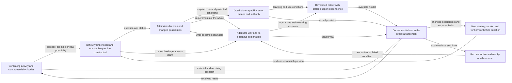

## C.40.OD - Construct and Continue Open-Ended Development

> **Type:** Method pattern
> **Status:** Stable
> **Normativity:** Normative

### C.40.OD:1 - Problem frame

Use this Method when worthwhile development depends on several kinds of work and their connections are not yet workable: someone can formulate a direction but not obtain its means; a provider supplies a result but the intended recipient acquires no new capability; research, product work and learning compete for the same people; or a successful intervention leaves no way to recognise and organise the next worthwhile transition.

The intended result is a feasible, revisable construction of development for named subjects, with the Methods, performers, means and receiving uses that make it possible. It includes a description of the relevant connected transformation flows and an arrangement that can perform the needed work. The description is a means of construction and coordination. Its production is not the development of the described subjects.

Open-ended development here concerns growth of knowledge, understanding or Methods that expands attainable reproducible results and enables further worthwhile problems. The growing result can be public knowledge, a better way of obtaining results, a holder's capacity to construct such ways, or their connected change. Identify which growth is intended: a newly delivered service or a person acquiring an already established Method does not by itself establish this continuation. A difficult episode can begin before anyone has named a problem. Its continuation can require a different question, a different Method, a different arrangement or a different understanding of value. Completing current work, learning an established Method, creating a Method and implementing an agreed change can contribute to development; none establishes the whole by itself.

The Method is usable by a person arranging self-development with assistance, leaders and participants in an organization, a provider helping other subjects, or organizers supporting a practice among independent carriers. It does not grant a provider authority over a recipient or make every cultural carrier a member of a managed organization.

For one adequate bounded improvement with available means and no consequential connection problem, use its direct Method. Do not build a network description merely to redescribe that work. Conversely, a bounded contract may be one contribution to continuing development without promising to provide its whole future.

### C.40.OD:2 - Problem

Useful local results can fail to become development. A research finding does not reach an engineering choice; a course supplies knowledge without the conditions for its use; a new arrangement performs well only while its designer supplies every judgement; or support remains organized around an earlier problem after its recipient has changed.

A single lifecycle diagram hides these failures. It can put an epistemic result, a person's capability, an organization and a provider's work into successive boxes as though one object passed through them. An organization chart can hide the same problem from the opposite side: every box has an owner, but the required work and its conditions do not connect.

The practitioner must construct a connected whole without turning it into a compulsory universal sequence. Different subjects, questions and time scales need different Methods and different evidence. Some work can proceed independently. Some results need one another, some merely share scarce means, and some reveal a need to revise a previous decision.

### C.40.OD:3 - Forces

| Force | Tension to resolve |
| --- | --- |
| Useful continuation | Bounded commitments must finish, while development can continue from what they make possible. |
| Specificity | Professional Methods supply real substance; a general construction must connect them without pretending to replace their knowledge. |
| Joint feasibility | Locally attractive transitions can compete for the same capability, time, authority or funds. |
| Independence | Research, participant development, provider development and cultural continuation can have independently worthwhile results. |
| Self-development | Help can make a transition possible while leaving the recipient dependent on an external problem setter. The desired independence must be chosen, not assumed. |
| Cultural reach | A practice can become ordinary beyond its first provider, but adoption, competence, voluntary participation and effective use are different results. |
| Affordable support | Common means can reduce total cost; sharing can also create queues, incompatible standards or a monopoly over problem formulation. |
| Changing means | Cheap capable AI changes viable allocations. It does not erase the developing subject, its stakes, access conditions or responsibility relations. |

### C.40.OD:4 - Solution

Start with this recurrent situation: a subject can perform some worthwhile activity, but its current way does not let it formulate or accomplish a further worthwhile change. Its difficulty can be visible only in interruptions, dependence on a particular helper, repeated exceptions, displaced costs or a possibility that it cannot yet use. A useful initial construction connects changes in **ongoing work, problem formulations, available ways, the developing subject, provision and cultural continuation**. These are different objects; they do not travel through one common sequence.

The construction below is prospective. It describes transformations to arrange and the contributions on which they depend. It does not assert an obtaining E.18.NET network or make the following descriptions an exhaustive taxonomy of flows. Use the direct E.18 identity and change rules when selecting actual flow members. One described strand can require several members; two distinctions useful for the explanation can belong to one member.

#### C.40.OD:4.1 - Identify the growth and its receiving continuation

Begin with a consequential situation, not an office proposal. Name the subject whose possibilities are in question, the work or life situations that matter to it, and the available basis for describing its current position. A person, team, organization, technical system and cultural population require different descriptions. A provider, a paying organization and a participant can coincide in one case and differ in another.

Use C.40.OI and C.40.OC to bound and characterize the development inquiry. B.5.PI supplies the entry from an unnoticed or weakly understood difficulty in ordinary work. C.40.PC and C.40.CD help construct the problem and possible contribution when neither is settled. A discrepancy from a target is one entry; a newly accessible possibility, a dependence that has become costly, a changed environment or an unexamined limit after success can be another.

For each intended change, say what the subject could subsequently do or obtain, why that is worth pursuing, what it could lose, and which uncertainty matters now. A slogan such as “become a learning organization” does not yet distinguish changes. Compare, for example, a team that can obtain a qualified answer from an adviser, a team that can make that judgement itself, and a team that can construct and improve its own way of making such judgements. These can all be useful; their costs and evidence differ.

Keep the present work that must continue visible. Development need not suspend useful operation, nor must every limitation be removed before the next contribution. Rest, consolidation, deliberate termination of one direction and protection from overload can preserve the conditions for subsequent development.

An epistemic question can supply the consequential situation. State what knowledge, understanding or way of obtaining results should grow and what new results or questions that growth could make attainable. A scientific explanation can be a worthwhile result before a practical application is found.

Distinguish three claims: the current result became better, the available way or understanding grew, and that growth changes which further problems can be handled. Explain each relied-on connection. A routine service improvement can end with the first claim; it need not be redescribed as open-ended development.

#### C.40.OD:4.2 - Connect consequential work to a worthwhile question

Keep ordinary work running where it remains useful. Preserve enough of a consequential episode to recover what was being attempted, the way used, its premises and what actually happened. The episode may be a failure, an unexpectedly successful response or a newly available means. Use a sufficient established account directly. When different live explanations would change the continuation, distinguish them before selecting the repair. For example, inability to supply a result can concern an inadequate Method, unavailable authority or an unlearned operation. Sending all three into a training programme would give them the wrong continuation.

Problematisation transforms the subject's understanding of the situation and produces new formulations. Under B.5.PI, C.40.OI, C.40.PC and C.40.CD, relate the difficulty to something worth changing for that subject; expose the premise making the current way insufficient; and construct a question whose possible answers change action. Its result supplies two different receiving operations:

- Direction construction uses the question to compare worthwhile attainable changes, including the means, losses and support dependence of each.
- Method or knowledge inquiry uses the consequential unresolved operation or claim to search, adapt, construct or investigate a way. It need not wait for a fully settled strategy when what can be done affects what is worth choosing.

The returns matter. A technical inquiry that establishes a cheaper usable way can change the direction. A participant's objection can expose an unwanted result and change the question. An unavailable decision power can require a different undertaking. Do not freeze the formulation simply because one branch has begun work.

A **direction is ready for the next construction** when it specifies enough of the subject's changed possibilities and receiving conditions to distinguish ways of obtaining them. It need not settle every future question. “Use a consultant's answer”, “make this judgement with obtainable help”, and “organize and revise our own way of making this judgement” specify different results even when all three begin at the same failed project.

#### C.40.OD:4.3 - Construct the joins that make a developmental whole

Connect the question to an obtainable epistemic or practical contribution. Then connect that contribution to the conditions of its use and to a further possibility opened by the changed position. A research result can change a problem formulation before a new application is built. A newly developed Method can make another result reproducible before anyone needs to acquire a new personal skill. A holder-development branch is selected only where the intended continuation requires it.

When the obtaining way, the holder's capability and provision depend on one another, use C.40.JD to construct those joins. Its return distinguishes delivered work, acquired capability, improved Method and retained help. When a qualified result is already obtained but the next worthwhile problem is unclear, use C.40.NP. Its return identifies what the changed position enables, including a justified local stop and preserved future possibility. These Methods can be used independently of this whole: one joins a present construction, the other starts from a result.

Do not require all branches. A theory-building inquiry may continue through a new question and a discriminating explanation without a training programme. A practitioner may use a developed way with an unchanged provision arrangement. A better AI configuration may remove a human operation while a different undertaking deliberately retains human mastery as an independent result. Keep the chosen end visible when changing its means.

The useful whole is an explained construction of actual transformations and their dependencies. A list of research, teaching, operation and management activities leaves the joins to be invented. For each consequential join, show what the supplying work returns, what the receiving work does with it and what condition makes that use possible. Adequate existing contributions are reused at their qualified scope. Obtain or develop only what is missing.

#### C.40.OD:4.4 - Keep provision and current activity connected

Provision is not a last box after the development plan. It supplies conditions consumed at several joins: access for problematisation, subject expertise for constructing the way, protected opportunity for practice, permission for consequential use and continuing support for another carrier. Its own development can therefore be a genuine dependency. It can also proceed independently for several later uses.

One person can perform ordinary service work, develop its Method and help another person use it. These are distinct Work contributions without necessarily being distinct positions or organizational units. Compare their joint demand against actual capacity. Likewise, a research result can have its own scientific purpose while contributing to a product direction; the product does not become its only justification.

Embed the development undertaking in the surrounding activity. Preserve the ordinary results that cannot be displaced, identify what each development alternative would displace, and settle that choice with the actual resource owner. A project boundary, a Method boundary and an organizational boundary answer different questions. A residence coordinator can develop a way of running programmes and also run current cohorts; drawing two project branches has not doubled that person's available time.

#### C.40.OD:4.5 - Use and vary the connected description

The following drawing compresses the explained construction. Boxes denote described work and results; labelled arrows summarize prospective receiving connections. They do not assert generic world-side relation occurrences or one object passing through a lifecycle.

The drawing omits internal professional transformations, the multiplicity and timing of occurrences, exact participant signatures and most failure returns. Read those from the explanation and direct Methods, not from arrow direction. For an actual E.18.NET claim, identify member flows and qualifying cross-flow relation occurrences under their direct governors. The proposed drawing does not supply that assurance.

Enter where a sufficient result is already available. An existing adequate Method can enter at the way and its receiving use; an established capable holder need not repeat learning. A missing source claim can open an inquiry without creating a whole training programme. Remove a branch only when its contribution is unnecessary or supplied elsewhere under compatible conditions. Keep a real unresolved contribution visible instead of silently calling it done.

#### C.40.OD:4.6 - Compare alternatives that remain whole

A useful alternative specifies a possible change and enough of its means, costs and receiving use to judge whether it can work. C.40.DC and C.40.JF supply direction/support construction and joint qualification; C.40.CU supplies the development of a useful reproducible whole. Reuse an adequate answer and develop its missing connections.

Several routes can be live together:

- **A usable Method exists.** Obtain its result, use it, adapt it or develop the capability to perform it, according to the sought result. A course is not required when a qualified provider is the sufficient alternative.
- **The Method exists but is not feasible locally.** Change access, support, allocation or the Method's contextual realization. If that exposes a poor direction, return to direction construction.
- **The proposed way is underdeveloped.** Use C.39 and C.40.CD/CU to construct and try it. Do not sell established provision of a result that the proposed way cannot yet supply.
- **A consequential knowledge claim is unresolved.** Use the applicable research practice. Independent research can also be worthwhile without an immediate product customer; give it its own result, conditions and resources.
- **The participant can perform the work only with continuing help.** Compare maintained support with a learning transition and a different division of work. Neither dependence nor independence is universally superior.
- **The current arrangement produces the result but blocks further development.** Compare changes to problem formulation, authority, learning opportunity and support, not merely faster execution of the same routine.

These branches can rejoin or reopen one another. They are not stages that every undertaking must complete in order. A fully formed local question can enter near its receiving use; a failed trial can return to the underlying purpose rather than repeat an unchanged solution.

#### C.40.OD:4.7 - Obtain the contributions that realize the construction

Use the first real receiving occasion to define a bounded realization. Which contribution will be made, by whom, with which means, on what terms, and what will its recipient then be able to do? Keep the uncertainty that the first attempt is meant to resolve. A charter, budget and meeting schedule can enable this work without being its intended result.

Prepare the proposal with the participants whose contributions it requires and obtain the effective decisions, commitments and first useful handover under their actual authority and participation conditions. Voluntary participants must be able to decline or qualify their contribution. For a subject uncertainty, use [B.5.SD](https://github.com/ailev/FPF/blob/main/FPF-Spec.md#b5sd---construct-a-useful-answer-through-substantive-discussion); for incompatible contributions, identify the conflict in result, burden, timing or authority and obtain a workable agreement, revised proposal or truthful stop before relying on the combination. Recover the proposal in the participants' own working terms; let them consult trusted advisers; distinguish misunderstanding from a correctly understood objection; revise the proposed work, conditions or distribution of gains and losses where the objection is material. Make the accepted contributions mutually knowable before relying on them. This work can change formulation and selection, not only implement a completed strategy.

An employer's proper authority, a professional obligation, a voluntary commitment and agreement to a service are different bases. A sponsor cannot settle all of them through one signature. When a needed contribution is unaccepted, outside the person's power or beyond available capacity, return to the relevant construction rather than hide it in the implementation plan.

When organizational realization is needed, obtain the joined contribution under its ordinary and exception conditions while preserving continuing service and concurrent commitments. Where a human capability is part of the promise, reuse sufficient current evidence about that person, later Work and permitted support. Obtain learning, practice, feedback and transfer results only for the needed acquisition, change or new use; an adequate supplied service can instead answer a promise that requires the result rather than the person's own capability. Engineered means need their own construction and qualification. The relevant subject practices retain the mechanisms and authority for these results. Observation and evaluation use the evidence required by the actual claim, not the mere completion of activities.

When the first attempt fails, locate what the result changes. Inadequate purpose, a wrong Method, a missing capability, unavailable means, a broken cross-flow connection and an unsupported success claim need different repairs. Preserve useful performed work and warranted results while changing the failed connection.

#### C.40.OD:4.8 - Make the way reconstructible in further use

Keep the decisions needed to operate the arrangement available at their actual point of use: purpose and strategy, contribution and support architecture, authoritative commitments, research questions where present, and the Methods that govern recurring work. These are different products. They need not become one document per named pattern, and their hierarchy need not reproduce the Library's framework hierarchy.

A local framework is justified when recurrent local practice needs a coherent language of Methods and their relations. Use E.4.DPF to construct it from the actual local problems and supplier results; identify variation, authority and the conditions that reopen an adaptation. Do not copy whole DPFs into every project. A contract or resource allocation is not replaced by an LPF, and a single project may need only a few adequately explained local instructions.

Carry a proposed Method into an actual work occasion with sufficient explanation, capability and means. Observe both conformity where it matters and the receiving result. When local adaptation works, distinguish what can be reused from what depends on local facts. When it fails, return to the responsible Method or architecture decision rather than treating failure as disobedience by default.

The typical network thus remains an aid to constructing and revising concrete practice. Its useful invariant is the recoverable connection among developing subjects, consequential problems, viable transformations, actual means and further development. Its layout and allocation can change.

#### C.40.OD:4.9 - Qualify continuation without promising infinity

Compare what the construction promised with what it actually made possible. An improved explanation, a new Method, a prepared performer and an accessible offer are different results. Use each result's own qualification and preserve the support on which it depends. The same observation can support one claim and leave another unresolved.

Show the resulting continuation through a real or well-specified next question: what can now be asked or obtained that could not adequately be obtained before, why it matters, and what makes its next move attainable. The continuation can expand a class of problems, change a generation or evaluation regime, or improve the means of obtaining further improvements. More output on the old task does not establish those changes.

Finite observations qualify particular transitions and the working means of continuation. They do not prove that every future problem will be solved or that the process will continue forever. Stop an exhausted or harmful branch, preserve useful knowledge and return to another worthwhile question when conditions warrant it. A provider's bounded contract can end while the recipient or independent cultural carriers continue.

### C.40.OD:5 - Archetypal Grounding

#### C.40.OD:5.1 - From repeated replanning to a different way of committing work

This is a constructed case. Its observations and resource figures are stipulated to expose the Method; they are not a report of an intervention or estimates for other organizations.

A small engineering company integrates business-data feeds for customers. Two project leads use a reliable planning routine for familiar integrations: inspect an agreed input format, divide the work into known tasks, estimate them and reserve people. In a new integration, the first sample passes the existing tests, yet later exports contain revised records that must replace earlier versions. The plan treated every later record as a new item. Adding more execution capacity would produce the wrong report sooner.

The immediate customer result is an adequately processed report. The proposed development result is different: project leads should be able to notice when the basis of a commitment is unestablished, construct a useful inquiry and revise the obtaining way before making that commitment. The company also wants this practice to continue without an adviser choosing every next question. A consultant could repair the current integration without producing those latter results.

The first lead initially frames the problem as inaccurate estimation. With a development adviser, she reconstructs the episode: which input premise was used, why the first sample supported it only weakly, and where the later output ceased to mean the intended business quantity. They contrast the episode with a familiar feed whose replacement semantics are documented and covered by suitable tests. This shows that the consequential difference is not simply project size or programmer speed. In the new case, the necessary processing operation depends on a source behavior that has not yet been established.

The lead therefore changes the question from “How many more days do we need?” to “Which source behavior must we establish to choose a valid processing way, and what can we responsibly commit before that is known?” The adviser asks for the competing implications rather than supplying a schedule. The subject specialist helps formulate two feasible possibilities: a feed with stable record identities and explicit revisions, or one without sufficient information for reliable automatic replacement. The first permits a bounded processing construction; the second requires changed source provision or a narrower agreed result. A small obtained source history, its interpretation with the data owner and a replay against a known correction can distinguish those possibilities for this decision.

This inquiry is not automatically a scientific research programme. Existing professional knowledge may be enough to construct and interpret it. It is also not useful merely because it is called discovery. It must return the particular contribution that changes the commitment. The lead arranges access to a permitted history and obtains the owner's explanation; the specialist examines the relevant semantics; the lead works through what each possible result permits. They preserve the existing task-estimation routine for the part whose premises remain valid.

The resulting way contains a conditional commitment, not an optimistic average of incompatible plans. Obtain and interpret the decisive source behavior; choose the compatible processing operation; qualify it for the actual receiving meaning; then commit the dependent work with its remaining assumptions. If source provision cannot support either acceptable route, return that restriction to the customer and direction choice. Protect unaffected current service while this work proceeds.

The supplied contributions now have exact receiving uses. The episode gives problematisation a failed premise and its consequence. The revised question gives the specialist an interpretable inquiry. The qualified source result gives the lead a basis for selecting a processing way and commitment. The explanation of that selection supplies the learning work with the judgement to practise. The eventual project result is consumed by the customer; the lead's changed capability is a separate claim.

#### C.40.OD:5.2 - Preserve the construction under materially different conditions

For independent practitioners, no employer can allocate every carrier's time or require disclosure. The same explanation and specialist return may be supplied by a publisher, association or service on acceptable terms; cultural continuation can occur without a communicating group. For a qualified AI arrangement, some inquiry and processing work may be obtained directly from agents. Retain human learning only where it remains an intended result or required contribution, and examine the combined arrangement under its actual powers and access.

For MIM's development, research can have an independently worthwhile scientific result as well as possible product uses. Developing a residence Method, preparing coordinators, running current cohorts and helping a particular participant develop are not one flow. A coordinator can contribute to all of them; their joint demand remains real. The typical construction supplies the joins to expose and develop, while strategic inquiry, research, human-capability development, comparison of competing undertakings under shared provision and the actual professional practice supply their substantive work. The MIM case neither converts all research into immediate client service nor establishes the Method's general boundary.

### C.40.OD:6 - Bias-Annotation

The main distortion is to begin with a familiar institution, course or flowchart and make every problem fit it. Recover the developing subject, work and consequential variation before selecting those forms. Another distortion is to equate autonomy with absence of support. Compare the degree and kind of independence actually worth developing.

A further bias treats success on a prepared case as evidence for the whole proposed culture. Ask which subject changed, which further use was shown and what remains a supported expectation.

### C.40.OD:7 - Conformance Checklist

- Can the reader distinguish the intended development from current work, Method acquisition, Method construction and delivery of help?
- Does each consequential connection name the contribution and receiving use, with a workable return when its conditions fail?
- Are the proposed flow description, actual transformations, performed Work and organization claims kept at their supported status?
- Can the selected arrangement supply the needed capability, resources and authority together with continuing work?
- Does the next transition arise from the changed subject's position, with a bounded attainable contribution rather than a compulsory endless workload?
- Can another carrier obtain and adapt the relevant Methods without the unpublished invention of the first organizer?
- Does the claimed growth concern knowledge, understanding, Methods or the means of obtaining further development, with ordinary output and acquisition of an existing Method separately described?
- Is a further attainable question connected to the changed position without a promise of endless success?

Use the questions needed by the actual claim; they are not a demand to complete every branch.

### C.40.OD:8 - Common Anti-Patterns and How to Avoid Them

**The office is the solution.** Recover the work and support network before and while comparing organization concepts.

**Everything involving Methods is development.** Identify the subject, worthwhile change and continuation being claimed.

**The arrow establishes the relation.** Qualify the direct relation and its local conditions; retain a proposed description where facts are missing.

**One successful service proves recipient mastery.** Keep delivery, assisted performance, transferred capability and self-development distinct.

**All research feeds today's product.** Preserve independent research ends and their actual relation to the rest of the portfolio.

**The new AI removes every human purpose.** Recompare the whole allocation against the actual retained result and duties.

**The example defines the Method.** Keep case assumptions local and test consequential changes that could defeat the promised use.

### C.40.OD:9 - Consequences

The undertaking becomes constructible and revisable across disciplines. The practitioner can locate an unavailable contribution, compare provision and change a failed connection without restarting everything. Development can continue after a bounded success without requiring the same office, provider or project forever.

The Method costs effort in recovering relations and comparing whole configurations. It does not remove professional knowledge, supply missing authority or guarantee cultural uptake. Use the smallest account that supports the consequential choices and deepen it where missing structure would change action.

### C.40.OD:10 - Rationale

The recurring difficulty is a failure of the connected whole, not necessarily the absence of an elementary operation. Existing FPF and DPF Methods already provide problem formation, construction, realization, capability development, organization design and cultural continuation. This Method makes their receiving relations and returns explicit for continuing development.

A connected description and a worked case can support understanding and prospective construction. Qualification of concrete outcomes remains with the actual subject, work and evidence. This distinction lets a typical network guide a future arrangement without asserting that its work has already occurred.

### C.40.OD:11 - SoTA-Echoing

The whole question is how to construct an attainable development undertaking, realize it through available or obtainable capabilities and means, and continue from the changed position without confusing that continuation with indefinite operation of the same project. For this question, a strong existing Library answer is direct use of C.32.MWA.PP, C.40.CU and the qualified subject Methods. C.32.MWA.PP already compares Method, Work, allocation, provision and other decision-changing relations, including joint burden and realization conditions. C.40.CU already connects an examined response to a useful application, alternative obtaining arrangements, realization, reproduction and condition-sensitive renewal. Subject Methods supply the actual research, learning, engineering or organizational operations. This is a serious sufficient alternative, not merely a choice of office diagram. When the practitioner can obtain the required result and its next continuation from that composition, use it directly; the present pattern requires no additional modelling exercise.

The remaining difficulty arises when individually adequate contributions leave the developmental connections to private invention: how a newly noticed limitation changes the problem and the obtaining way together; how the agent's present capability enables its next capability development; how immediate delivery, development of a performer and provision rejoin without one standing in for another; and how success opens further development and cultural continuation. The original contribution here is the developed construction of those joins in C.40.OD:4, C.40.JD:4.1–4.3 and C.40.NP:4.1, their supplier-change derivation in C.40.JD:4.4, and their post-success and further-carrier uses in C.40.NP:4.2–4.3. The worked case follows a failed commitment premise into a changed decision capability and then a harder carrier-development question. These moves reuse A.12, B.5.PI, C.39, C.40.CD/CU, E.23.CDI and C.36/C.36.RP; E.18/E.18.NET, C.30.TFS-REL and C.32.MWA retain the distinctions needed to describe and realize the construction. The gain claimed is an obtainable explanation for this connected work, not a new universal development mechanism or measured superiority over a competent direct composition.

For organizational provision, Rebecca Peters's [CIPD analysis, 9 July 2024](https://www.cipd.org/uk/views-and-insights/thought-leadership/insight/transforming-operating-models), compares central, local and hybrid HR arrangements in relation to purpose, continuing operations and provider capability. This pattern adapts that comparison to the support-remit choice; it does not transfer an HR configuration as a generally optimal development office.

Ina M. Sebastian, Peter Weill, Thomas Haskamp and Jan vom Brocke's [MIT CISR study, “Designing Decision Rights for AI”, 18 June 2026](https://cisr.mit.edu/publication/2026_0601_AIDecisionMatrix_SebastianWeillHaskampVomBrocke), distinguishes framing, action and learning decisions under risk and ambiguity. Its interview-based examples include local business ownership combined with common AI expertise and infrastructure. Here that is a source for examining which decisions and contributions can be distributed or shared; its human organizational roles are not mandatory roles for every agent arrangement. Neither this study nor the CIPD cases establish comparative effectiveness for every community. The applicable organizational Methods and C.32.MWA.PP retain the operative organizational construction; implementation-support practice supplies needed help in an enactment, not the prior definition of every development question.

The 2024 essays on role communities [inside a company](https://ailev.ru/1741032.html) and [around a company](https://ailev.ru/1741983.html) motivate attention to overlapping organization/community relations, participants' own journeys and competing formal and informal influence. They are conceptual contributions, not evidence for universal predictions about human replacement or office disappearance.

C.18 distinguishes exploration within a possibility space, expansion of operations or regions, and a changed generation or evaluation regime; C.19 governs which live branches receive further resources. E.23 distinguishes improvement from improvement of its obtaining means. C.36/C.36.RP supply cultural reconstruction, use, selection and renewal. Their differences prevent one score, one new version or one copied exercise from standing in for open-ended development. Subject practices still supply actual learning, research, computational and organizational mechanisms.

### C.40.OD:12 - Relations

C.40.OI, C.40.OC, C.40.NU, C.40.PC, C.40.DC, C.40.JF, C.40.OP, C.40.RQ and C.40.OCN supply opportunity and direction construction; this Method uses those results and returns changed premises. C.32.MWA.PP supplies comparison of performance/support architecture across supplied Methods; C.39 and C.40.CD develop an obtaining way. Organizational realization, human learning and transfer, engineered means, research and strategic commitments remain separately qualified subject contributions when the undertaking needs them. A.15.9 obtains the missing result and its reliance limits without prescribing one framework as its supplier.

C.36/C.36.RP and C.36.MC supply the general cultural-continuation questions. For a separately selected leadership or community engagement, the applicable leadership Method supports proposal preparation, decision and first use, and the applicable community Method supports voluntary participation. E.4.DPF supplies a local language when recurrent local practice warrants one.

These use and support relations do not by themselves establish constructive Method parthood, a universal work sequence or a containing organization.

C.40.JD develops the joint construction of a way, its holder and provision. C.40.NP develops continuation from a qualified result. Each can be used for its own result without constructing a larger undertaking. C.40.CD constructs a problem and way together; C.40.CU constructs a reproducible application. C.40.OCN can supply a bounded opportunity without a continuing-development commitment.

### C.40.OD:End
